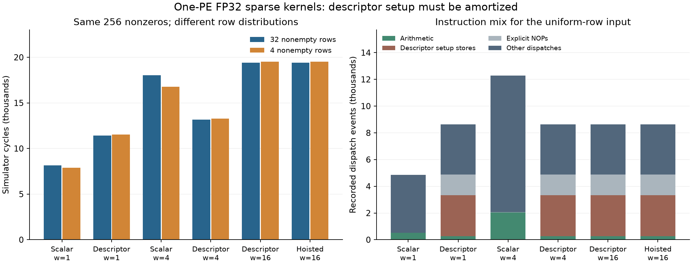

# Local sparse trace and prediction pilot — 24 September 2026

Executed on the **NVIDIA GPU node with Cerebras SDK 2.10.1**, targeting WSE-3 in the simulator. Six retained sparse binaries passed **144 traced launches**. A model derived from their traces then predicted **four new controlled cases exactly**, with **48 additional correct launches**. There were no new compilations, model/API calls, or physical WSE measurements.

This pilot uses the existing hand-written scalar, descriptor, and source-hoisted kernels from `sparse-crossarch-20260922`. The September 22–23 agent-generated O1I SpMV and SpMM bundles were unavailable on this node and were not committed on the reviewed `sparse_ipdps` tip. Therefore these results test the profiling method and sparse mechanisms; they do not independently validate those agent improvements. The framework revision reviewed was `cb3785baa4201832b4cdbe7324aff00383f77ea4`, and the sparse branch remained `7413ed46fa0f572f4b46e7fd9b7056462a31a770`.

## Execution and correctness

All cases have one application PE, 32 sparse rows, 64 columns, 256 nonzeros, FP32 operands, and output width 1, 4, or 16. Uniform input has 32 rows of length eight; skewed input has four rows of length 64 and 28 empty rows. Thus dimensions and nonzero count are identical, while row distribution changes.

Each kernel/input runs in three sessions: original inputs, changed indices/values/dense operand, then restored original inputs. Each session has one warmup and three measurements. Output storage is poisoned before a session, and every output is checked against a host FP64 sparse oracle. Inputs use exactly representable small integers. This is an exact arithmetic/indexing/state-reset check, not a substitute for cancellation and general floating-point tolerance tests.

The trace replays use copied original ELFs without recompilation or inserted device instrumentation. All 144 output hashes and kernel timing samples match the original measurements. Source, ELF, disassembly, input, and trace hashes are retained. All timed dispatch encodings match the measured ELF; timestamp anchors reproduce all saved intervals; all **258,048 multiplication results**, along with the corresponding scalar additions or FMAC outputs, are checked against their traced operands. No discarded CTF events or SDK error diagnostics occurred.

The timer includes output initialization and kernel work. Host transfers and host oracle construction are excluded. This is local SRAM-resident computation; it measures no inter-PE communication. Both local SDK lock conventions were acquired, and SDK runs were serialized.

## Result 1: descriptor setup has a workload-dependent payoff

| Kernel | Output width | Uniform cycles | Skewed cycles | Uniform dispatch events | Descriptor setup stores |
|---|---:|---:|---:|---:|---:|
| Scalar SpMV | 1 | 8,163 | 7,883 | 4,855 | 0 |
| Descriptor SpMV | 1 | 11,429 | 11,513 | 8,633 | 3,072 |
| Scalar SpMM | 4 | 18,044 | 16,784 | 12,280 | 0 |
| Descriptor SpMM | 4 | 13,181 | 13,265 | 8,633 | 3,072 |
| Descriptor SpMM | 16 | 19,420 | 19,504 | 8,632 | 3,072 |
| Source-hoisted descriptor SpMM | 16 | 19,420 | 19,504 | 8,632 | 3,072 |

Values are identical across the three measurements, the warmup, and all three input-change sessions within each configuration. “Dispatch events” denotes the simulator trace event, not hardware instruction retirement. Setup-store counts are the stores to the descriptor configuration addresses emitted for the FMAC operation, checked against the exact disassembly.

For the uniform input, descriptor SpMV is **1.40× slower** than scalar SpMV, while descriptor SpMM at width four is **1.37× faster** than its scalar counterpart. The descriptor kernels program twelve configuration words for each of 256 nonzeros and execute six explicit NOP instructions per nonzero. They therefore perform the same 3,072 setup stores and 1,536 setup-associated NOPs at all three widths. Four further NOPs are inside the measured timer scope. Wider output spreads this setup across more useful products.

This comparison also changes scalar multiply/add instructions into descriptor FMAC instructions; it is not a pure setup-only ablation. Store and NOP counts do not establish their runtime percentages. The floating-point result spans for a descriptor FMAC are 1, 7, and 31 cycles at widths 1, 4, and 16, respectively, in these simulator traces. A result span excludes preceding setup and is not a universal operation-latency or hardware-throughput claim.



The [PDF](sparse-trace-results.pdf) and [SVG](sparse-trace-results.svg) are standalone exports. The figure uses the compact [summary](summary.json).

## Result 2: the unsuccessful hoist is explained below the source

The descriptor and source-hoisted width-16 programs have identical timing, dispatch counts, executed PC sequences, opcode counts, descriptor-store counts, and FMAC result spans for every corresponding launch. The static instruction comparison differs at just four initial instructions: two constant loads and two stack stores appear in a different order. The loop body is unchanged.

The source rewrite therefore did not remove descriptor setup from the executed loop. This is stronger evidence than reporting that a proposed optimization did not improve timing: it identifies why the intended reduction did not occur. A future descriptor-reuse candidate should demonstrate reduced emitted setup or altered execution before it is described as successful hoisting. No improvement from such a future candidate is claimed here.

## Result 3: row distribution changes local control-flow cost

Equal dimensions and nonzero counts do not imply equal local time. Moreover, the direction of the effect depends on the compiled implementation.

The analysis partitions elapsed cycles into intervals from each recorded dispatch to the next, including the ending timestamp anchor. These intervals sum exactly to the measured time. They are **not instruction latencies or hardware stall counters**: intervening work and dependencies can contribute. In this paired comparison, the changing intervals can nevertheless be located precisely in the emitted control flow.

For descriptor SpMV, moving from 32 nonempty rows to four produces:

| Changed portion of the dispatch timeline | Skewed minus uniform cycles |
|---|---:|
| Intervals after the empty-row check | +84 |
| Intervals after the nonzero-loop continuation check | +84 |
| Three setup instructions skipped for 28 empty rows | −84 |
| **Total change** | **+84** |

The relevant conditional-branch successor intervals are three or six cycles in these traces. This does not establish a universal WSE branch penalty or the presence/absence of branch prediction. Some encoded unconditional jumps have no separate dispatch record; successor classification follows the exact static jump chain instead of assuming every instruction appears in the dispatch stream.

For scalar width-four SpMM, the two corresponding branch contributions are also +84 each, but skipped nonempty-row setup/output work saves 1,428 cycles, for a net **−1,260 cycles**. That is why row concentration helps the scalar program but slightly hurts the descriptor program in this experiment. The complete PC and successor accounting is in [dispatch-gap analysis](dispatch-gap-descriptor-n1-scalar-n4.json).

This is a local-computation finding. Concentrating nonzeros on fewer rows could simultaneously worsen load balance across PEs. A wafer-level partitioner must account for both effects and for operand movement.

## Result 4: a small model predicts new cases

For these two fixed compiled kernels, the observed row setup and branch intervals imply the following conditional models, where R is the number of nonempty rows, with all other dimensions, nonzeros, widths, and timing scope held fixed:

```
Descriptor SpMV: T(R) = 11,429 - 3 × (R - 32)
Scalar SpMM, width 4: T(R) = 18,044 + 45 × (R - 32)
```

The models use only the 32-row and four-row measurements and their trace accounting. Predictions were written to [model-check-registration.json](model-check-registration.json) **before** executing new matrices with eight and sixteen nonempty rows. The new column indices use a separate deterministic construction, while values retain the same numerical range. Each case repeats the original/changed/restored sessions and four launches per session.

| Kernel | Nonempty rows | Predicted cycles | Observed cycles | Correct launches |
|---|---:|---:|---:|---:|
| Descriptor SpMV | 8 | 11,501 | 11,501 | 12/12 |
| Descriptor SpMV | 16 | 11,477 | 11,477 | 12/12 |
| Scalar SpMM, width 4 | 8 | 16,964 | 16,964 | 12/12 |
| Scalar SpMM, width 4 | 16 | 17,324 | 17,324 | 12/12 |

All 48 launches match exactly. These are controlled interpolation checks, not validation across real-matrix families, different dimensions, different programs, or silicon. They are separate from the agent study's training/validation/final-test split. Results and the registration hash are in [model-check-results.json](model-check-results.json).

## An element-level view of the measured SpMM

For the first nonzero of uniform width-four SpMM, the stored CSR row range is `[0,8)`, the column index is zero, and the sparse value is −2. The descriptor reads the dense row `[-3, -1, 1, 3]` and updates the initially zero output row. The measured FMAC is at PC 462. Its first result occurs four cycles after its dispatch; subsequent result events are two cycles apart:

| Cycle relative to first result | Output element | Recorded update | Recorded result |
|---:|---|---|---:|
| 0 | C[0,0] | 0 + (−3) × (−2) | 6 |
| 2 | C[0,1] | 0 + (−1) × (−2) | 2 |
| 4 | C[0,2] | 0 + 1 × (−2) | −2 |
| 6 | C[0,3] | 0 + 3 × (−2) | −6 |

These are actual simulator operand/result events, matched to the input files, not an illustrative reconstruction. They show a single descriptor operation producing a sequence of scalar FP32 results. The first three arithmetic instructions per launch are preserved as small examples in the full local trace audit.

## Implications and next experiments

- Select scalar versus descriptor processing using output width and measured setup, rather than assuming descriptors always improve a sparse kernel.
- Check the emitted loop when evaluating source hoisting. Explicit descriptor reuse is a candidate to test, not an already measured improvement.
- Include nonempty-row count and row-control behavior in a local cost model. Nonzero count and density alone miss the observed effects.
- Consider compact nonempty-row traversal for empty-row-heavy inputs, while preserving zero outputs and charging preprocessing cost. The new model is a guide for this experiment, not evidence that the transformation has already succeeded.
- Recheck these mechanisms on WSE-3 hardware and then add communication and completion timing. Simulator branch intervals and operand-service rates must not be imported directly as silicon constants.

To apply this method to the paper's agent result, the next required handoff is the exact retained source, layout, host, inputs, compile command, measured ELF, and raw trial records for SpMV O1I seeds 2/3 and SpMM O1I seed 1, with matching frozen starts. A reconstructed program based only on the reported transformation name would not constitute independent replay.

## Reproduction and artifact locations

The full local archive is `/home/USER/sparse-trace-pilot-20260924`. Raw CTF traces occupy approximately 2.82 GB and remain outside Git. The original binaries and matrix inputs come from `/home/USER/sparse-crossarch-20260922/wse` and are unchanged.

To prepare a fresh run, copy this study's Python scripts into a **new home-directory workspace**, then run:

```bash
python3 prepare_replays.py --source-root /home/USER/sparse-crossarch-20260922/wse --output-root "$PWD"
python3 run_replays.py
python3 analyze_sparse_traces.py --root "$PWD" --trace-library /path/to/xkernel/studies/wse3-characterization
python3 analyze_dispatch_gaps.py --root "$PWD" --trace-library /path/to/xkernel/studies/wse3-characterization --cases descriptor-n1 scalar-n4
python3 prepare_model_checks.py
python3 run_model_checks.py
```

The SDK launcher path in the runners is local to this node. `prepare_model_checks.py` uses the published model coefficients to reproduce the registered experiment; it does not refit a new model. NumPy is required for preparation; Matplotlib is needed only for the optional figure. The simulator host runs inside the installed SDK container.

The original trace registration was written before the six replays. The standalone preparation command was saved afterward from that preparation procedure. The separate model registration was written before all four prediction checks. The [evidence manifest](evidence-manifest.json) records hashes and locations for the complete local evidence as well as the compact published files. No agent experiment or manuscript was modified.
