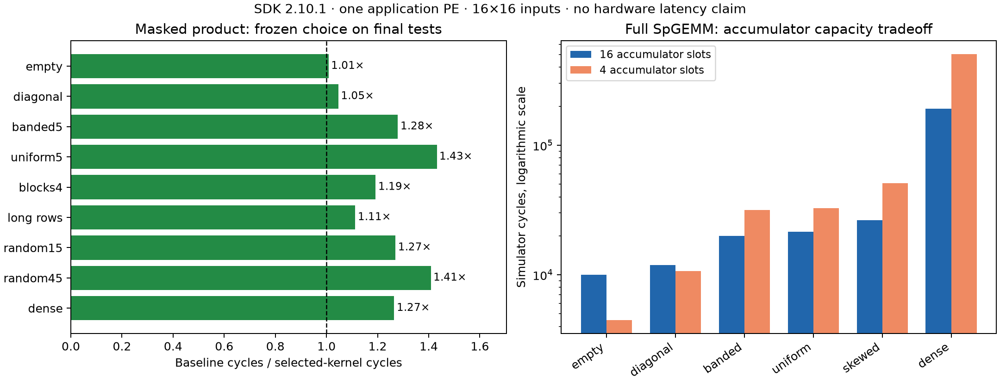

# Compiler and accumulator experiments for sparse products — 24 September 2026

Executed on the **NVIDIA GPU node with Cerebras SDK 2.10.1**, using one WSE-3 simulator PE and 16×16 inputs. This follow-up turns the previous trace hypothesis into controlled CSL transformations, evaluates a frozen choice on separate matrix families, and implements a full sparse A×B product with generated CSR output. No models/APIs or physical WSE hardware are used.

## Masked product: a controlled source rewrite improves the compiled loop

All six sources were frozen before measurement. Select the correct merge variant with the smallest geometric mean cycle ratio on the three selection families. The selected variant uses explicit continuation after each cursor update. Its output contract remains masked A-transpose×A, with separate numerical and structural-presence buffers.

| Implementation | Banded cycles | Uniform cycles | Skewed cycles |
|---|---:|---:|---:|
| Original merge | 16,941 | 20,461 | 30,237 |
| Named end offsets | 16,941 | 20,461 | 30,237 |
| Explicit cursor paths | 14,033 | 15,077 | 24,797 |
| Named ends + separate bounds | 15,957 | 18,141 | 27,671 |
| Combined rewrite | 15,207 | 16,135 | 26,175 |
| Nested matching | 19,376 | 17,696 | 43,088 |

Naming the end offsets alone saves no cycles in this comparison. Separating bounds checks helps, but combining it with explicit cursor paths is slower than explicit cursor paths alone. Source transformations therefore cannot be assumed to add their benefits.

The emitted unequal-index path changes from selecting a stack address and performing an indirect load/increment/store to computing conditional register increments. The rest of the loop and register allocation also change; the whole speedup is not assigned solely to those removed memory operations. Exact-binary traces below verify that useful arithmetic and outputs remain the same.

## Frozen choice on final-test matrix families

The selection decision was saved before these matrices were executed. No candidate was revised using their results. Each complete family has original, changed, and restored sessions, each with one warmup and three timing samples. Output and structural buffers are poisoned before every session. These are small synthetic structural tests, not size scaling or a new agent benchmark cohort.

| Final family | Original merge cycles | Selected merge cycles | Nested cycles | Speedup over original |
|---|---:|---:|---:|---:|
| empty | 4,431 | 4,395 | 4,400 | 1.008× |
| diagonal | 6,207 | 5,931 | 6,032 | 1.047× |
| banded5 | 37,704 | 29,470 | 57,936 | 1.279× |
| uniform5 | 47,560 | 33,220 | 54,376 | 1.432× |
| blocks4 | 25,503 | 21,387 | 35,840 | 1.192× |
| long rows | 10,303 | 9,259 | 10,656 | 1.113× |
| random15 | 14,193 | 11,175 | 13,109 | 1.270× |
| random45 | 98,508 | 69,946 | 182,501 | 1.408× |
| dense | 312,927 | 247,371 | 1,358,912 | 1.265× |

The frozen choice is faster on **9/9** original-input final families and equal on 0; its geometric mean speedup over original merge is **1.216×**. Against nested matching, it is faster on 9/9 comparable families. These counts describe matrix families for one manually rewritten kernel, not model-generated benchmark successes.

## Full SpGEMM: discover and emit sparse output

This experiment computes arbitrary sparse A×B and discovers its output pattern. It emits sorted CSR and retains structurally present zero values after cancellation. The full-row accumulator has sixteen slots; the tiled version uses four slots and repeats row traversal for four output tiles. The declared value/presence arrays shrink from **96 to 24 bytes**. This is not a fourfold reduction in total PE storage: input, output, descriptor, library, and stack allocations also matter.

Timing includes scratch initialization, product traversal, accumulation, capacity checks, and CSR emission. Output capacity is preallocated to 256 entries; dynamic allocation, input packing, and transfers are excluded. This is a bounded general-product prototype, not a scalable SpGEMM library or an end-to-end cuSPARSE comparison.

| Input | Products | Structural output entries | Full-row cycles | Four-slot cycles | Four-slot / full-row time |
|---|---:|---:|---:|---:|---:|
| empty | 0 | 0 | 10,018 | 4,458 | 0.445× |
| diagonal | 16 | 16 | 11,858 | 10,722 | 0.904× |
| banded | 144 | 80 | 19,986 | 31,554 | 1.579× |
| uniform | 144 | 144 | 21,586 | 32,674 | 1.514× |
| skewed | 292 | 68 | 26,518 | 51,010 | 1.924× |
| dense | 4,096 | 256 | 191,618 | 505,962 | 2.640× |

The four-slot implementation is faster on empty and diagonal inputs, but slower on the tested inputs with more products. The compiler turns its presence clear into two 32-bit stores and unrolls the four presence/output checks. The full-row version uses a clearing helper and an indexed output scan. Meanwhile, every sparse B-row index is revisited for each output tile. Useful products are computed once. Thus smaller scratch can help low-work cases while repeated traversal dominates other cases. A universal preference for either accumulator size is unsupported.

A candidate solution is to partition or index B rows by output tile so each owner visits only relevant entries. This would add preparation, metadata, and communication costs; it has not been implemented in this experiment. With sixteen columns, saved scratch is only 72 bytes, so extra indexing metadata could exceed the saving. A larger-scale evaluation must account for total storage and reuse.

## Trace and model evidence

Accepted LLVM IR captures reproduce both measured ELFs byte for byte. In the original IR, pointer-valued phi nodes join the two cursor addresses before a shared load/increment/store. The selected IR has no such pointer merge, and the emitted code uses conditional register increments. Its captured kernel actually has more branch instructions (73 versus 59), despite lower measured time. [IR_NOTES.md](IR_NOTES.md) explains the stage, identity checks, and why static branch counts or cycles per dispatch alone are misleading.

All traced dispatch encodings match the exact measured ELF. Trace timers, input hashes, output hashes, and measured cycle counts agree with the original runs. Every scalar multiply/add result is checked against its traced operands, and the product counts agree with an independent traversal. No discarded CTF events are accepted.

| Traced implementation | Input | Cycles | Dispatch events | Useful products |
|---|---|---:|---:|---:|
| Full SpGEMM, 16 slots | banded | 19,986 | 11,697 | 144 |
| Full SpGEMM, 16 slots | uniform | 21,586 | 12,849 | 144 |
| Full SpGEMM, 4 slots | banded | 31,554 | 18,841 | 144 |
| Full SpGEMM, 4 slots | uniform | 32,674 | 19,721 | 144 |
| Original masked merge | banded | 16,941 | 10,730 | 112 |
| Original masked merge | uniform | 20,461 | 13,261 | 28 |
| Selected masked merge | banded | 14,033 | 8,262 | 112 |
| Selected masked merge | uniform | 15,077 | 8,861 | 28 |

The audit covers 16 traced launches and 1,712 multiplication results plus the same number of additions. Dispatch events are not retired instructions; intervals between dispatches are not universal instruction latencies or hardware stall counters. Full PC/branch accounting is preserved in the compressed audit.

The full-row banded and uniform inputs both generate 144 products but emit 80 and 144 output entries. Their 1,600-cycle difference suggests 25 extra cycles per emitted entry for this compiled loop under these fixed conditions. Two fresh matrix pairs were registered before execution to test the model:

| Fresh input | Products | Output entries | Predicted cycles | Observed cycle values |
|---|---:|---:|---:|---|
| probe928 | 144 | 121 | 21,011 | 21011 |
| probe930 | 144 | 115 | 20,861 | 20861 |

All eight launches match the predictions exactly. This is a conditional model for one ELF, fixed dimensions, and fixed row degrees. It is not a universal CSR-store latency or a validated hardware model.

## Correctness, failures, and evidence limits

- Selection: 216 recorded correct numerical launches and 0 capacity/reset checks.
- Final: 324 recorded correct numerical launches and 0 capacity/reset checks.
- General: 144 recorded correct numerical launches and 12 capacity/reset checks.
- Independent model probes: 8 correct launches.
- Exact-binary trace replays: 16 correct launches.

The full-product capacity tests include dense output limits of 0, 64, 255, and 256; empty output with limit zero; and recovery on a subsequent diagonal input. Insufficient capacity returns an explicit failure status and a correct bounded prefix. Guards and unused output entries remain intact. These expected capacity responses are separate from successful full-product timing comparisons.

Two initial full-product host invocations failed because the new harness reversed the SDK copy-call arguments. The correction changed only host code and reused the same ELFs. The first corrected tiled suite then exceeded its 420-second wall-time watchdog; that attempt is retained and the unchanged binary was retried with a recorded longer limit. Per-session checkpoints were added outside device timing. These harness failures are not compiler or numerical-kernel failures.

The arithmetic tests use exactly representable small integers, including signs and cancellation. They do not replace general floating-point tolerance tests, large real matrices, multi-PE balance/communication measurements, or physical WSE replay. Simulator cycles remain separate from measured GPU/CS-3 latency. These are deterministic reference experiments, not evidence of an agent or guidance-condition improvement.

## Artifacts and handoff

The [PDF](spgemm-followup.pdf) and [SVG](spgemm-followup.svg) are standalone exports. See [METHOD.md](METHOD.md) for contracts and amendments, [summary.json](summary.json) for all input sessions and comparisons, and [HANDOFF.md](HANDOFF.md) for the hardware-node handoff.

Local archive: `/home/USER/spgemm-followup-20260924`. Raw traces, original and measured ELF bundles, complete observations, and all failed attempts remain there. The local `replay-bundles.tar.gz` contains the compact build bundles for transfer. Sources, registrations, compact tables, compressed observations/audits, and hashes are committed. SDK image identity and source/ELF/trace hashes are retained in the evidence manifest.

Reviewed base commits: framework `v2_0` `196523eb1e25b832d9f6fa8a665838c042c751e3`; sparse branch `7413ed46fa0f572f4b46e7fd9b7056462a31a770`; paper `bb7f61ad30873f64ebca758101f5e03d313c37d9`. This node supplies evidence; it does not edit the manuscript.
