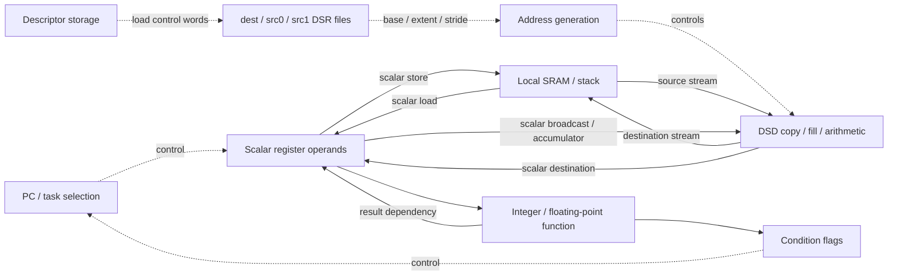

# WSE-3 PE datapath review: GEMM, Add, and memory operations

Reviewed 2026-09-15. Open the [interactive comparison](results/anatomy/datapath_review.html)
or inspect its [machine-readable evidence](results/anatomy/datapath_review.json).
Reproduce with `python3 tools/datapath_review.py`; this reads retained artifacts
and executes no device program.

Follow-up: the [PE-hop review](PE_HOP_REVIEW.md) reconstructs full wavelet words
from both `index` and `data`, binds GEMM/GEMV transfers to instructions and numeric
uses, and corrects the relay's per-word router intervals. It supplies the network
side of this functional datapath review.

The layered PE/time presentation uses **SVG with an orthographic 3D projection**.
The older `tools/mesh3d.html.tpl` uses Three.js `WebGLRenderer`. This new datapath
comparison also uses SVG and HTML, with embedded data and no external runtime.

The evidence supports a MIPS-style **functional datapath plus a partially observed
instruction timeline**. It does not determine a MIPS five-stage pipeline or a
physical WSE circuit schematic. In particular, stage numbers 3 and 6 are simulator
trace identifiers; those identifiers alone do not prove six physical pipeline
stages. Instruction operands identify functional transfers. Controlled spacing
sweeps constrain when dependent operations can proceed.

## What was checked

The exporter reads the raw `events.jsonl.gz` and corresponding ELF disassembly for:

- `microbench/atomic_add`: scalar i16/f16 and vector f16 additions.
- `microbench/atomic_ops`: fill, contiguous copy, strided copy, and the surrounding instructions.
- All 11 `microbench/pcsweep` classes: descriptor readiness, scalar load-use,
  integer and f16 dependencies, store/load visibility, flags, and reduction.
- G0/G1/G2 GEMM, both history and history-free control captures in
  `results/gemm-walkthrough/try-20260914d`.

It also reads the checked single-PE memory suite, simulator bank probe, and
accepted, non-warmup silicon bank-stride trials from `results/wse3-full/ledger.jsonl`.
That last comparison uses retained timing results, not a silicon instruction trace.
It is a separate calibration workload, not a matched execution of the bank probe.

Each instruction is joined by **capture, tile, UID**, then PC to disassembly.
Every selected dispatch, S3, and S6 record retains its **1-based decompressed JSONL
line number**. Payload-free S6 records are retained separately from operand-bearing
records. Many normal instructions produce both at the same cycle; counting both
as completed elements or treating the first as a stall would be incorrect.

All controlled-pair dispatch spacing, inserted NOP counts, dispatch bubbles, and
S3-to-first-value intervals are recomputed from raw records and checked against
the saved sweep results: **91 pairs across 19 raw captures**, with zero in every
capture's maximum reported discarded-event counter. The comparison has 37
selectable instruction windows. All **640 GEMM products** are independently matched again:
**1,280 FMULS/FADDS instructions**, each with exact source and result bits.
The retained control readbacks pass; their individual instructions are not bound
to tensor indices in this comparison.

## Datapath inferred from the workload comparisons

These are functional connections, not measured buses or separate physical units.
The diagram separates descriptor control words from numerical operands. The
documented DSR model has destination, source-0 and source-1 files and requires
DSD operands to be loaded into them before use. That agrees with the descriptor
load instructions in these captures. [Cerebras DSR documentation](https://sdk.cerebras.ai/csl/language/dsrs).
Memory and fabric descriptors describe different operand sources/destinations;
this review's local-compute windows do not establish fabric-queue circuitry.
[Cerebras DSD documentation](https://sdk.cerebras.ai/csl/language/dsds).

| Comparison | Observation | Supported interpretation | Not established |
|---|---|---|---|
| Scalar Add | `ld16`, `ld16`, `add16`, `st16`; 1234 + (−4321) = −3087 | Scalar memory → register → arithmetic → memory path | Register-file port count or bypass mux |
| Immediate `ld16 → add16` | At one-instruction spacing: no extra dispatch or S3→value delay | This tested 16-bit load-use case proceeds without extra delay | Universal load latency; f32/pointer-chase behavior |
| DSR load → vector Add | Extra dispatch bubble 3, 2, 1, 0 as K becomes 0, 1, 2, 3 | Descriptor readiness constrains dispatch in these cases | Whether the mechanism is a scoreboard, bypass, or another interlock |
| Prepared DSR control | Vector operation retains S3→value = 4 | That extra cycle is not removed by preparing the descriptors | Internal placement of that cycle |
| f16 Add → dependent f16 Add | At K=0: S3→value = 4; at K≥1: 3 | An adjacent dependent f16 add has an extra observed cycle | f32 latency or physical feedback path; this class checks timing/markers only |
| `st16 [x] → ld16 [x]` | S3→value = 5, 4, 3 at K=0, 1, 2; consumer dispatch itself has no bubble | Same-address producer/consumer spacing changes the load's value timing | Store commit instant, store buffer, same-bank/different-address behavior |
| Reduction to scalar | Successive accumulator elements are spaced two cycles apart | Accumulator recurrence limits this f16 reduction | General serialization of all DSD operations |

The table is a model of the tested instruction forms. A hazard result for a RAW
edge does not automatically apply to WAR/WAW edges, other widths, other stream
types, or concurrent microthreads.

## GEMM exposes memory dependencies around the arithmetic

The first G0 history product is a concrete example. It computes 1 × 1 and adds
the product to an old accumulator of zero. The actual instruction window contains:

| UID | Instruction | Dispatch / S3 | Operand-bearing S6 |
|---:|---|---:|---:|
| 2009 | `fmuls d0 = d0, d2` | 4013 | 4016 |
| 2010 | `st32 sp[0x16] = d0` | 4014 | 4018 |
| 2011 | `ld16rp d0 = sp[0x14]` | 4015 | 4019 |
| 2012 | `ld16rp d2 = sp[0x16]` | 4016 | 4021 |
| 2013 | `fadds d0 = d0, d2` | 4018 | 4022 |
| 2014 | `st32 sp[0xc] = d0` | 4019 | 4024 |

Source: `g0-history/events.jsonl.gz`, tile 12. The linked comparison supplies the
exact raw rows and operand words for each UID. The `st32` and `ld16rp` address the
same symbolic stack slot while the stack base is unchanged in this window.

The product travels through a stack spill/reload before the add. The add's
four-cycle S3→value interval is **an observation in this mixed instruction stream**,
not a clean measurement of f32 add latency. The preceding store/load and older
in-flight instructions are confounding factors. Applying the f16 dependent-add
rule directly would be unjustified.

G0/G1/G2 add PE placement and tiling; they do not establish new functional units.
These scalar `optnone` programs deliberately expose every product and accumulator.
The history writes and checkpoints substantially change timing: G0 takes 29,724
local timer cycles with history and 4,455 without. Use the history build for
values and provenance, and compare controls for overhead. Neither represents
optimized DSD GEMM throughput. Local timer origins differ from simulator cycles.

### Comparison with the larger retained kernels

The separate [cross-workload opcode summary](results/datapath/xworkload.json)
also covers WaferLLM MeshGEMM/MeshGEMV, GELU, and Dot-Product. I reviewed that
summary and its `tools/datapath_xwl.py` collector; these larger traces are **not
part of the 19-capture raw re-audit above**.

| Context | Cached observation | Interpretation |
|---|---|---|
| MeshGEMM, selected PE, cycles 70,000–82,000 | 1,280 FMACH instructions; 16 elements each; first element group at S3+4, groups two cycles apart | A DSD FMA path that differs from the scalar FMULS/FADDS teaching program |
| MeshGEMV, selected PE | 176 FMACH instances with the same 16-element grouping | The observed vector schedule recurs in another workload |
| GELU | 5,632 FADDS instances; S3→first lane minimum 3, median 4, maximum 6 | Four cycles is not a universal invariant of this mnemonic |
| Dot-Product | 512 FADDS instances, all at four cycles | Identical timing within one schedule still does not isolate intrinsic latency |

The vector-add raw audit independently shows eight f16 records per group and
two-cycle spacing for the longer Add cases: **eight results in one recorded
group does not mean eight results every cycle**. It is consistent with a
128-bit execution group, but does not uniquely establish a physical 128-bit bus
or the number of memory ports.

Two qualifications are necessary before interpreting the larger summary as a
processor specification. Its opcode statistics include runtime instructions on
the selected PE, so cross-workload agreement can partly reflect shared runtime
code. Also, a minimum is the **smallest observed interval**, not proof that an
unstalled instance was present. Identical minima strengthen a candidate model;
they do not prove its unit latency. A matched opcode/operand-form and dependency
control is still needed. The collector also closes/reopens a UID on redispatch,
so its microthread exclusions should be treated as a collector limitation rather
than proof that microthreads inherently make instruction identity unusable.

## Read, write, and copy are different experiments

The single-PE A suite verifies every output and checksum. Its long cases show:

| Operation | Elements | Measured cycles | Elements/cycle | What the program does |
|---|---:|---:|---:|---|
| Read | 12,288 | 12,303 | 0.9988 | Drains a DSD into a scalar destination |
| Fill/write | 12,288 | 1,550 | 7.9277 | Broadcasts a scalar into a memory DSD |
| Copy | 8,192 | 1,044 | 7.8467 | Memory DSD → memory DSD |
| Stride-2 copy | 8,192 | 2,098 | 3.9047 | Every second source element → contiguous destination |
| Stride-4 copy | 8,192 | 4,146 | 1.9759 | Every fourth source element → contiguous destination |
| Stride-8 copy | 8,192 | 8,242 | 0.9939 | Every eighth source element → contiguous destination |

These finite-workload numbers include setup and loop work. The scalar-destination
read is not a measurement of aggregate SRAM bandwidth. In the atomic copy traces,
eight contiguous f16 elements appear together, while stride 2 spreads eight
elements across two cycles. This supports a descriptor-driven element-delivery
constraint; it does not identify a bank crossbar or count read ports.

The simulator's read/write bank-offset probe is almost flat, including its
alignment control. The silicon calibration has alignment-dependent timing.
Therefore, flat simulator results cannot establish absence of bank conflicts
on hardware. The comparison page exposes the hardware trial medians separately.
There are 100 accepted non-warmup trials per alignment/stride case: for stride 2,
alignments 1 and 5 take 529 cycles versus 273 for the others (1.938×). For stride
8, alignment 3 takes 529 and alignment 7 takes 781 versus 273 (up to 2.861×).

## Corrections and limits of the earlier presentations

1. `FINDINGS.md` contains older DSR and load-use statements superseded by §10l's
   controlled sweeps. Those cross-references are updated with this review.
2. Intermediate positions drawn between S3 and S6 in a pipeline diagram must be
   labeled unknown/interpolated. They are not observed operand-read or memory stages.
3. The existing `pe_model.py` dependency matcher uses textual register/address
   names. It does not resolve overlapping r/d register names, changing indirect
   addresses, or complete DSD memory footprints. Its graph is a partial functional
   explanation, not a complete hazard detector.
4. Its `sweep_for()` uses broad resource/unit classes, so an FP pair can receive
   f16 support without checking width/opcode, and sweep support can be attached
   to edges other than RAW. This review instead presents the exact controlled
   class beside its own records; it does not use that support mapper to establish
   new GEMM stall causes. The legacy mapper remains unchanged pending a stricter
   per-opcode evidence contract.
5. The older fabric discussion attributes redispatch to a queue becoming nonempty.
   When arrivals precede dispatch, redispatch alone cannot locate that transition;
   queue readiness/hand-off is the bounded interpretation. Queue occupancy and
   exact hand-off timing need an additional probe.

## Experiments that would resolve the remaining ambiguity

| Priority | Probe | Controlled comparison | Question answered |
|---|---|---|---|
| 1 | Store → load | Same/different address, same/different bank, K=0…8, 16/32-bit; verified values | Address visibility versus bank effects; whether the GEMM spill case follows the 16-bit rule |
| 2 | f32 multiply/add chains | Register-only dependent chain, independent chain, and spill/reload form; identical checked values | Arithmetic recurrence versus spill-induced delay |
| 3 | Descriptor readiness | Change one DSR field or role, vary length, compare preloaded descriptors | Which descriptor changes cause the dispatch interlock |
| 4 | Memory access on silicon | Verified addresses and alignment, positive control, matched vector length/dtype | Which simulated memory-path rules hold on WSE-3 hardware |
| 5 | Receive → compute | Data early/late, queue status snapshots, varying lengths and microthreads | Queue readiness, redispatch, and completion-task hand-off |

Every probe should preserve ELF/IR, source and placement hashes, exact disassembly,
raw record references, checked outputs, and a control that removes the suspected
dependency. Device-internal timer measurements alone cannot place an operation in
a physical pipeline stage. No new simulator or hardware job was run for this review.
