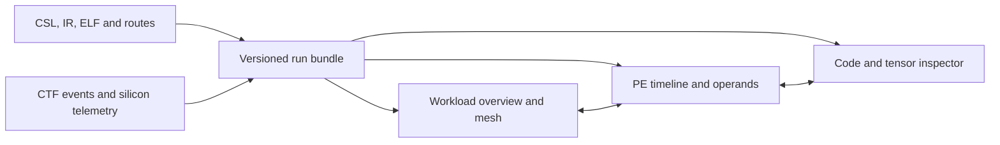

# WSE-3 workload explorer: artifact review and implementation plan

Reviewed 2026-09-14; revised to prioritize small, numerically inspectable GEMM microbenches and their fundamental dataflow. The first executable implementation is now available; the broader roadmap below still includes future work.

Research objective update, 2026-09-16: the
[architecture and performance-model roadmap](ARCHITECTURE_MODEL_PLAN.md) sets
the next experimental priorities. The viewers connect exact value lineage to
controlled architectural hypotheses and predictions for new workloads. Later
[input-placement](viewer/INPUTS.md) and [PE-hop](PE_HOP_REVIEW.md) audits supersede
the historical packet-binding gaps described in the checkpoints below for their
documented tiny GEMM/GEMV captures.

## Implementation checkpoint — 2026-09-14

The [tiny GEMM walkthrough](microbench/gemm_walkthrough/README.md) implements G0,
G1, and G2 with generated CSL, an SDK capture runner, an independent numerical
exporter (`study.py viz-export`), and a TypeScript viewer packaged as
[`results/gemm-walkthrough/gemm.html`](results/gemm-walkthrough/gemm.html).

Six serial SDK 2.10 simulator runs in `results/gemm-walkthrough/try-20260914d`
cover history-enabled and history-free versions of all three scenes. All 640
product contributions and 96 final outputs agree with the reference. All 640
contributions also match ordered scalar FMULS/FADDS execute operands/results.
The exporter checks 2,690 numerical comparisons, including panel readbacks;
all control outputs agree and all three history traces report zero discarded
events. Timing is explicitly simulator evidence with instrumentation overhead.

The linked viewer provides matrix/PE selection, partial sums, logical panel
transfers, local buffer offsets, accumulator versions, prediction exercises,
assembly/IR/CSL, dynamic instruction context, and observed dispatch/execute
timelines. It distinguishes local TSC ticks from simulator trace-cycle origins.
ELF load segments establish placement. Captured IR requests now use atomic
unique filenames because concurrent compiler workers could otherwise overwrite
each other's records.

Still ahead: packet-to-element binding, observed load/store address histories,
queue/backpressure reconstruction, larger workload adapters, optimized DSD/FMA
comparisons, and matched hardware measurements. The present dataflow diagram
shows functional dependencies; it does not assert internal forwarding circuitry.

## 1. Recommendation and feasibility

The layered presentation now adds an independently implemented, CNN-inspired
node-link stack: repeated mesh planes at recorded times, numeric buffer cells,
temporal PE connections, checked logical MeshGEMV transfers, and a linked PE
dataflow inspector. It supports camera controls and standalone SVG export using
the same six-scene time bundle. See the [layer-view guide](viewer/LAYERS.md).

Implementation update, 2026-09-15: the
[MeshGEMV walkthrough](microbench/gemv_walkthrough/README.md) adds V0/V1/V2
(4×4 on one PE, 4×4 on four PEs, 8×8 on four PEs), preserving the retained
X @ W orientation and vertical combination of partials. Six simulator captures
verify 96 local products, 12 reduction adds, 39 phase checkpoints, and 28 output
replicas. A separate time-slice presentation covers these three scenes plus the
three GEMM scenes, with event/fixed-cycle stepping and per-PE numeric changes.
MeshGEMV phase boundaries are bound through ELF function ranges and checked
flags/readbacks; exact packet-to-element mapping remains future work. The small
scalar f32/two-peer implementation is explicitly distinguished from WaferLLM's
larger f16/DSD/two-tree implementation.

Build one linked workload explorer on the existing Python decoders and PE model. The primary audience is kernel researchers, with a guided tour using the same records. Start with a handwritten 4×4 GEMM on one application PE, distribute that same calculation across four application PEs, then increase it to 8×8. Retained atomic-ops and relay traces provide decoder controls; new tiny GEMM captures become the first user-facing demonstration. Larger retained workloads follow after the numerical story is verified.

The useful navigation chain is **matrix entry / output tile → dot-product terms and partial sums → owning PE and communication phase → task/microthread → dynamic instruction → CSL / captured LLVM IR / assembly → observed operands**. Selection and time should stay synchronized across that chain. The study already contains most of the infrastructure; the first addition is an explicit mapping between mathematical values, local storage, communication, and execution records.

Detailed replay is feasible for the SDK simulator. Silicon can contribute validated timings, phase markers, explicit telemetry, and comparisons. The retained evidence does not establish a cycle-by-cycle silicon instruction or router replay, physical defect remapping, complete queue occupancy, or internal forwarding circuitry. Missing observations must remain visible as missing.

The inspected shell is on `login-node`, with access to the shared study and `/software/cerebras/cs_sdk-2.10`. This review used local inspection and offline tests; it submitted no simulator or appliance jobs. Future SDK work belongs on a suitable user/service node and must remain serial per node, following the repository's execution workflow.

## 2. What the artifacts establish

### Reusable assets

| Layer | Existing evidence and implementation | Implication |
|---|---|---|
| Placement and routes | ELF-derived fabric profiles, route tables, coordinate mapping, layout SVGs | Use compiled roles and coordinates as the spatial skeleton, including runtime and route-only PEs. |
| Dynamic mesh behavior | Raw CTF, decoded events, conservative wavelet graphs, 2D replay, six cached 3D scenes | Reuse decoding and route templates, but preserve all observations independently of animation. |
| PE execution | `anatomy_common`, `pe_model`, atomic operations, producer–consumer sweeps, relay-compute | Dispatch, redispatch, decode, execute elements/lanes, values, and dependencies can support a detailed inspector. |
| Compilation | Captured LLVM IR with debug locations, backend/linker requests, objects, ELFs, disassembly, DSR allocation graphs | A source/IR/assembly view is practical for retained builds. It is not a compiler-pass execution history. |
| Hardware measurement | Calibration records, raw TSC words, synchronization references, campaign ledger | Compare validated measurements by operation and phase, with their own provenance and clock domain. |
| Presentation | Anatomy pages, PE datapath page, mesh stages, 3D flow/trellis, Perfetto export | Consolidate useful interactions into shared state instead of adding another independent page. |

The six scene JSON files total about 2.69 MB. The full MeshGEMM scene reports 1,058,919 dispatches, 543,122 wavelet observations, and 6,726,734 pipe records. This demonstrates that compact overviews are practical even when raw detail contains millions of records.

The atomic-ops capture metadata references an old `out_cap` ELF path. The current `out/bin/out_0_0.elf` matches its recorded 16-hex SHA-256 prefix, and the retained object matches its recorded prefix too. Artifact discovery should recover moved files through content identity, record full hashes, and retain the distinction between a recovered candidate and a complete original run binding.

### Findings that affect the next implementation

1. **PE role classification is wrong in the relay scene.** The fallback in [mesh3d_scenes.py](tools/mesh3d_scenes.py) treats the presence of floating-point arithmetic as evidence of an application PE. Both relay application coordinates `(4,1)` and `(5,1)` are cached as `support`; relay-compute's sender is also `support`. Derive allocated PE roles from layout/source metadata. Track the origin of an executing instruction separately, since application PEs also execute runtime instructions.

2. **Dispatch density and execution activity need separate metrics.** Fine bins contain dispatch counts, even when the UI calls them “compute” or “occupancy.” All six cached fine-bin totals match their dispatch totals exactly. That validates the counts, not an interpretation as utilization. A single DSD dispatch can produce many execute records over several cycles. Expose dispatch density, observed execute activity, FP element activity, and wavelet observations as distinct channels with explicit denominators and bin widths.

3. **The fabric heatmap is coupled to the rendered subset.** [mesh3d.html.tpl](tools/mesh3d.html.tpl) computes trellis activity while iterating rendered paths. Full MeshGEMM keeps 65,854 reconstructed packets, one in three, and its retained templates expand to 179,853 point observations versus 543,122 raw wavelet observations. Even unsampled relay has 247 reconstructed point observations versus 261 raw observations. Singleton/repeated observations, branch handling, render caps, and layer rounding also matter. Count traffic directly from raw observations; use a separately labelled subset only for drawing.

4. **The 3D extractor simplifies paths more aggressively than the trace library.** It removes repeated coordinates and rejects non-cardinal chains. The existing [wavelet graph implementation](wse3study/trace.py) preserves branches and ambiguous predecessor candidates. Use that conservative graph as the semantic representation. Template compression is lossless only for the represented structure and fields; it does not make the current scene a lossless raw-trace archive.

5. **Preserve complete dynamic instruction histories.** The 3D summary pairs decode with the first stage-6 record. The PE model already distinguishes first and last execution/value records. The inspected relay-compute receive UID has three dispatch records, at cycles 2462, 2464, and 2466. Do not collapse these into a single duration or overwrite all but one redispatch. Unknown PCs also occur and must remain inspectable.

6. **Provenance is richer upstream than in scene caches.** Current scene JSON has no complete run/build/ELF binding. The decoded `event_id` is an event type identifier, not a unique record identifier: relay-compute repeats IDs 2, 3, and 6 thousands of times. Use a raw stream locator or source-row ordinal for unique records. Keep observed values, decoder rules, and inferred relationships separately attributable.

7. **Some reports and prose are historical snapshots.** The campaign report is dated August 18 and reports 0/49 qualified detailed traces; the later microbench and anatomy artifacts have additional evidence. Neither the old completeness total nor an isolated newer page describes the entire current corpus. Rebuild a dated capability inventory, and qualify conclusions such as “compute-bound” with sufficient evidence: a phase containing arithmetic and no observed traffic does not by itself prove a limiting resource.

8. **The tool baseline has changed.** Current [Cerebras SDK GUI documentation](https://sdk.cerebras.ai/debug/sdk-gui) explicitly supports WSE-3 instruction traces starting with SDK 2.10. The [SDK 1.4 release notes](https://cerebras-sdk-docs-140.netlify.app/sdk-release-notes/sdk-rel-notes-cumulative) describe the earlier limitation. Benchmark the installed 2.10 GUI and its reader against small retained traces before reproducing its basic features. ALCF documents [SDK setup and GUI access](https://docs.alcf.anl.gov/ai-testbed/cerebras/csl/).

### Lessons from the supplied examples

These are design adaptations, not proposals to import their domain models or entire applications.

| Reference | Pattern to adapt | WSE application |
|---|---|---|
| [llm-viz](https://github.com/bbycroft/llm-viz) | A working small example, spatial organization, guided exploration | Follow one known operation from workload placement to PE execution; retain 3D for an optional space-time view. |
| [GNN-101](https://github.com/Visual-Intelligence-UMN/GNN-101) | Linked abstraction levels, node-link and matrix views, calculation explanations | Link mesh communication to logical tensor tiles and then to operands used by a selected instruction. |
| [Gosling examples](https://gosling-lang.org/examples/) and [linked-track tutorial](https://gosling-lang.org/tutorials/create-multi-track-visualization/) | Brushing, linked tracks, semantic zoom | Brush a cycle range once; overview, PE timeline, traffic, and code respond together. Zoom reveals events and values progressively. |
| [nn_vis](https://github.com/aharley/nn_vis) | Behavior tied to concrete input and activations | Show verified inputs, received values, and outputs for small kernels. Input changes select a matching captured run; animations do not invent a new execution. |

The external review covered documentation, repository descriptions/manifests, and accessible page content. Local review covered generators, HTML source, scene data, IR, disassembly, raw events, and tests. Browser rendering and interaction performance were not exercised in this session.

## 3. Proposed explorer and data contract

### First workload: a GEMM small enough to reproduce by hand

Use `C = A × B`, with zero-initialized C, no transposes, and f32 storage/arithmetic. Matrix dimensions describe the global matrices, not the PE grid. Introduce these cases in order:

| Case | Global GEMM | Application mapping | What the reader learns |
|---|---|---|---|
| G0 | 4×4 times 4×4 | One PE owns all 16 outputs; handwritten scalar loops | Follow all four terms of any dot product, its running accumulator, and final store. There are 64 mathematical product contributions. |
| G1 | The same 4×4 inputs | A 2×2 PE grid; each PE owns a 2×2 C tile | Follow initial A/B ownership, two panel-broadcast rounds, and each PE's partial and final tile. Each PE computes 16 product contributions. |
| G2 | 8×8 times 8×8 | The same 2×2 PE grid; each PE owns a 4×4 C tile | Repeat the same algorithm with 16 outputs and 128 product contributions per PE, 512 overall. |

These are mathematical work counts, not dispatched-instruction counts. Runtime/support PEs remain visible in the fabric view and excluded from the application-PE count.

Create the study-owned `microbench/gemm_walkthrough/` family using the existing [handwritten single-PE GEMM](../../kernels/GEMM-1PE/CSL/pe.csl) and [SUMMA GEMM](../../kernels/GEMM/CSL/pe.csl) as references. Keep the reference kernel bundles unchanged. Start with scalar local arithmetic in both the single-PE and tiled teaching variants, preserving ascending k order for each output. Use function-local `optnone` for those teaching captures and identify that compilation mode explicitly. After G0–G2 pass, add a normal optimized build and the existing DSD-based local update as comparison variants. Their instruction order and timing must come from separate captures.

**Fixed 4×4 example.** Upload these runtime inputs from the host, rather than embedding them as compiler constants:

```text
A = [ 1  2  3  4 ]    B = [ 1  2  3  4 ]
    [ 5  6  7  8 ]        [ 0  1  2  3 ]
    [ 9 10 11 12 ]        [ 2  0  1  2 ]
    [13 14 15 16 ]        [ 1  2  0  1 ]

C = [11 12 10  20]
    [27 32 34  60]
    [43 52 58 100]
    [59 72 82 140]
```

Opening example: `C[0,0] = 1×1 + 2×0 + 3×2 + 4×1 = 11`. Starting from zero, the accumulator is `1 → 1 → 7 → 11`. The UI shows each operand's indices as well as its value, so equal numbers are never treated as evidence of identical data origin. These results were calculated during planning; they are expected values, not captured WSE results.

For G2, use zero-based `A[i,k] = 8*i + k + 1` and `B[k,j] = ((3*k + 2*j) mod 5) - 2`; display the full input matrices and computed reference output. These small integers, their products, and all partial sums are exactly representable in f32. Require exact numerical equality for these teaching datasets. Additional fixtures use identity, zeros, asymmetric patterns, and seeded small signed integers to expose indexing and packing errors. General floating-point inputs and their rounding policies are deferred until this exact-value path is accepted.

### Explicit placement, communication, and partial sums

For G1 and G2 let tile size `t` be 2 or 4, respectively. Use application coordinates `(x,y)` where x increases across columns and y across rows. PE `(x,y)` owns `C[y*t:(y+1)*t, x*t:(x+1)*t]`, initially stores A tile `(y,x)` and B tile `(y,x)`, and retains its C tile throughout the computation. Request compiler offsets `(4,1)` and verify the realized mapping from the retained compilation:

| Logical PE | Requested compiler coordinate | G1 output ownership |
|---|---|---|
| (0,0) | (4,1) | C rows 0–1, columns 0–1 |
| (1,0) | (5,1) | C rows 0–1, columns 2–3 |
| (0,1) | (4,2) | C rows 2–3, columns 0–1 |
| (1,1) | (5,2) | C rows 2–3, columns 2–3 |

In round `s = 0,1`, PE `(s,y)` broadcasts A tile `(y,s)` along its row, and PE `(x,s)` broadcasts B tile `(s,x)` along its column. Each receiver waits for both panels before updating `C_local += A_panel × B_panel`, using global k values `s*t` through `(s+1)*t-1`. The math view can select a round across all PEs; the trace view preserves each PE's actual timing and does not imply a global barrier or simultaneous execution.

Expose three distinct numeric states: the contribution of the current product, the accumulated tile after each k, and the final owned tile. For G1, the global output assembled after round 0 must be:

```text
[ 1  4  7 10]
[ 5 16 27 38]
[ 9 28 47 66]
[13 40 67 94]
```

For PE `(0,0)`, round 0 contributes `[[1,4],[5,16]]`; round 1 contributes `[[10,8],[22,16]]`; its final tile is `[[11,12],[27,32]]`. Assemble all four final tiles into the expected global C. SUMMA accumulates these contributions locally: it does not reduce partial C tiles across PEs. A subsequent 4×4 split-K lesson can introduce that different algorithm explicitly: two PEs each compute a full 4×4 partial C over k=0–1 or k=2–3, then one sends its partial tile to the other for addition. This is a follow-on lesson after G2, not part of the first deliverable.

Show host packing separately from mathematical layout. The existing single-PE reference stores matrices row-major; the SUMMA reference stores each local tile column-major even though the host transfer enumerates PEs row-major. Record strides, element size, and base-address units. For a local t×t column-major tile, element `(i_local,j_local)` has offset `j_local*t+i_local`. The visualizer must prove this mapping through round-trip fixtures rather than infer it from the matrix picture.

### Numerical capture and handwritten replay

Each teaching capture retains the exact A/B arrays, initial PE buffers, received panels, accumulator histories, per-round C snapshots, final local C tiles, and reconstructed global output. Give every product contribution the semantic key `(run,i,j,k)` and an explicit owner. Store raw f32 bit patterns as well as decoded values.

Instrument study-owned teaching kernels with exported history buffers written after each accumulator update and after each completed panel receive. Read those buffers back after completion; browser stepping replays retained observations and does not launch a new host RPC per term. G2 needs only 128 accumulator samples per application PE. Record per-PE history indices and phase timestamps; link stores and arithmetic to actual dynamic instruction UIDs where trace evidence establishes the relationship. A snapshot is evidence of a sampled state, not proof of all intermediate cycles or a particular forwarding path.

Capture a companion build without history stores, check the same final output, and report the instrumentation overhead. Never combine its timing with the instrumented history as if they came from one execution. Keep the original IR, any patched teaching IR, final ELF, and the exact patch/build recipe together. Control the teaching function explicitly; marker stores alone do not guarantee compiler ordering.

Provide two linked modes:

- **Work through the math:** select an output entry or tile, step by one product, one completed dot product, or one broadcast round, and see `old accumulator + A[i,k] × B[k,j] = new accumulator`. Highlight the operands in the global matrices, their current PE/buffer locations, and the updated C entry. Expected values and device-observed values appear side by side with an equality indicator. An optional manual-answer field lets the reader predict the next accumulator before revealing it.
- **Inspect execution:** jump from that semantic step to its observed PE, cycle interval, task, instruction(s), CSL/IR/assembly, and element/lane records. When a precise mapping cannot be established, show the available region and an unresolved mapping. One mathematical update may correspond to several scalar instructions, or several updates may be handled by one DSD instruction.

For G1/G2, selecting a panel shows its logical entries, source and destination PEs, packing order, actual receive-buffer values, and available wavelet observations. Link logical payloads to packet data only when encoding and ordering are verified; equality of values alone is insufficient. Header/control traffic remains distinguishable from payload. Retain inferred path labels and show unobserved queue residency explicitly. Editing an input starts a clearly labelled host-only mathematical preview; it cannot reuse the old device trace as evidence for the new values.

### Fundamental dataflow is a required first-release view

Every tiny GEMM must explain how a number gets from its input location to an output, including the local computation and any communication. Add a **Follow this value** interaction to every matrix entry, product, accumulator, and output tile. It opens three synchronized levels:

| Level | Required detail |
|---|---|
| Mathematical dataflow | A row and B column form a dot product; show each product and successive accumulator versions. For tiled GEMM, also show each k step as an outer-product update of the local C tile. |
| Storage and movement | Show initial host placement, owning/replica PEs, local buffers and element offsets, panel transfers, buffer consumption, output storage, and host reconstruction. Distinguish reusing an existing value from loading or transmitting it again. |
| PE functional dataflow | Show the decoded source/destination resources, address calculation, operand loads or DSD streams, arithmetic, accumulator updates, stores, and the task/descriptor operations that enable them. Attach observed cycles and values where available. |

For the scalar teaching GEMM, expand a selected contribution into this logical sequence: locate A and B → calculate their addresses → obtain operand values → multiply → add to the previous accumulator → retain the new accumulator → store C when the dot product completes. The actual disassembly decides whether multiply/add are separate, whether a fused instruction exists in this build, and whether accumulator state occupies registers or spills to SRAM. Do not draw a register-only accumulator or one store per dot product if the captured build does something else.

For example, the third term of G0's `C[0,0]` follows `A[0,2]=3` and `B[2,0]=2` into `3×2=6`, then combines that with the previous accumulator `1` to obtain `7`. In the row-major f32 inputs their byte offsets are 8 within A and 32 within B; symbol bases come from the bound ELF. Show both these logical offsets and the machine's explicitly labelled address units. A register or memory location reused later receives a new value version, so the reader can follow the producer of the specific value consumed.

The DSD comparison must expose its different dataflow: descriptor configuration and DSR loads establish base, extent, stride, and operand role; they do not move the matrix payload. In the existing tiled GEMM's local update, a scalar `B[k,j]` is used with a column stream of A and a column stream of C to update `C[:,j] += A[:,k] * B[k,j]`. Expand the DSD instruction into its observed element/lane records. Show which rows those records correspond to and how many elements reuse the scalar B value; infer neither the lane width nor simultaneous execution from the tile size.

For G1, use PE `(1,1)` and `C[2,2]` as the first complete communication-to-computation example. During round 0, A panel `[[9,10],[13,14]]` comes from PE `(0,1)`, and B panel `[[3,4],[2,3]]` comes from PE `(1,0)`. Their column-major payload orders are `[9,13,10,14]` and `[3,2,4,3]`. Once both panels are available, `C[2,2]` receives `9×3=27`, then `10×2=20`, reaching 47. Round 1 adds `11×1=11` and `12×0=0`, producing 58. These are expected arithmetic and logical transfers; actual route, task, and cycle annotations must come from the new capture.

The communication view follows the logical path below. Each segment is labelled as compiled configuration, observed activity, or an inferred relationship; any unavailable segment remains explicit.


Draw task activation, completion conditions, and descriptor setup as control arrows separate from numerical data arrows. Readiness depends on both required panels, but the order of their arrival is read from the trace. Host-level transfers are shown as transfer operations unless their internal detail was actually captured. Queue presence and configured routes do not establish queue depth, backpressure, or an exact packet-to-operand association.

Extend the bundle with versioned value/resource nodes and typed edges for arithmetic use, storage reads/writes, communication/replication, and control dependencies. Each node carries its semantic indices, value bits where known, PE/resource location, producer or initial-input identity, and observation boundary. Each edge carries its derivation and raw-event references when available. Keep calculated products distinct from recorded intermediate results, and keep numerical dependencies distinct from an inferred physical forwarding path. Seed histories from recorded inputs/snapshots; an unobserved resource is unknown rather than zero.

The inspector offers **previous/next producer-consumer event** alongside cycle, product, and round stepping. A selected edge explains the concrete action, for example “read A[2,0] from the received A panel” or “reuse B[0,2] for the next row.” Show mathematical reuse separately from observed load counts, transferred payload bytes, and runtime/control traffic. These totals help explain how the scalar and DSD versions perform the same work differently.

Implement this as an extension of the existing PE functional model, not a gate-level reconstruction. Fetch, operand-read timing, pipeline internals, writeback timing, forwarding, and SRAM-bank arbitration remain unobserved unless a corresponding capture establishes them. Smooth explanatory motion is labelled as illustration; it must not imply measurements between recorded events.

### One workspace, linked views

- **Overview:** workload name, input shape, build/run identity, evidence coverage, and a cycle ribbon. Show the compiled fabric extent and allocated/loaded/observed PE populations separately. Begin in a 2D view of the occupied rectangle; show the full compiler fabric as context with sparse aggregation.
- **Mesh:** PE roles, route colors and directions, observed traffic, selection by PE/region/color, and optional animated paths. A 3D trellis uses time as its third axis and shares the same selection and time range.
- **PE inspector:** task and microthread tracks, all dispatch/redispatch/decode/execute records, PC/mnemonic, element/lane values, and the required value/resource dataflow view above. Queue IDs, task colors, microthread IDs, and SIMD lanes remain distinct controls and labels.
- **Code and data:** linked CSL, captured IR, disassembly, and the GEMM matrix/buffer view defined above. Tensor entries, ownership, packing, partial sums, and expected/observed outputs are required for G0–G2. Retain many-to-many source mappings; show function/region matches or unavailable mappings explicitly. Optimized marker windows are not assumed to correspond to one source statement.
- **Evidence panel and comparison:** any selected mark opens its source records and derivation. Compare optimized/optnone variants by named operation; compare simulator/silicon results by validated phase or operation, never by pretending they share an absolute clock.



Use cycles as the primary time unit. Record trace extent, selected window, and device-measured operation window separately; they can differ. Record logical, compiler-fabric, and simulator coordinates with explicit transformations. Do not infer physical remapping from these coordinates.

### Implementation interfaces

Keep the existing raw-event and campaign schemas compatible. Add a separately versioned visualization bundle, generated through a new `study.py viz-export --scene <scene-id> --out <directory>` command. Scene definitions explicitly bind input paths, coordinate metadata, optional measurement windows, and curated workload annotations. Missing capabilities yield usable partial views; contradictory bindings prevent the affected join.

The bundle contains:

- A manifest with full available artifact hashes, SDK/toolchain identifiers, build/run identity, coordinate transforms, clock domains, capture windows, completeness, available capabilities, and decoder/annotation versions.
- Static program data indexed by build, PE program, and PC; source/IR locations; route configuration; and available tensor/buffer annotations. Keep PC/address units explicit. A raw instruction word is available from dispatch records; an ELF dump or captured IR is static program evidence, not an execution trace.
- Dynamic instruction records keyed by run, PE, UID and its disambiguating lifetime, retaining all dispatch and stage records. Preserve context/task/microthread information and raw locators. Missing UID-lifetime evidence is flagged rather than guessed. Serialize wide identifiers/timestamps as strings when they exceed JavaScript's safe integer range.
- Raw wavelet observations plus inferred graph edges, including unmatched observations and branch ambiguity. Apply route constraints only when the exact compilation is bound; preserve decoder version and validation basis for field interpretation.
- Full-count multiresolution overview bins, indexed detail chunks, and an independently sampled rendering stream. Metrics never depend on draw limits or packet sampling. Each mark exposes evidence class, resolution, coverage, and the records supporting it.
- A workload section with operation/dtype/input identity; tensor shapes, strides and initial values; entry/tile ownership and replicas; communication rounds; `(i,j,k)` contribution records; expected and observed accumulator/panel/output snapshots; and optional links to raw events and dynamic instructions. Reference calculations and sampled device states carry separate origins. A semantic-to-instruction mapping includes its method and confidence rather than claiming universal one-to-one correspondence.

For the first implementation, use a Python exporter and a TypeScript/Vite static UI, Canvas2D for dense mesh/timeline views, SVG/HTML for the selected PE diagram and code, and locally bundled Three.js for the optional trellis. Reuse the existing semantic helpers instead of duplicating them in JavaScript. Use a Web Worker for detail loading/indexing and bounded caches. [Vite supports a static build](https://vite.dev/guide/static-deploy.html); the viewer needs ordinary local HTTP serving and can be copied to a workstation. Bundle dependencies locally rather than relying on the current Three.js CDN reference.

Store detail in JSON chunks indexed by PE and fixed 4096-cycle windows, with cross-window instruction/graph references retained. Load only the selected region. Save run, cycle range, PE, instruction, filters, and tour step in a bookmark. Export a selected record table and a figure with its evidence/coverage caption. Keep existing pages and Perfetto export available during migration; its current cycle-to-microsecond display mapping must remain explicitly labelled.

## 4. Implementation sequence and acceptance

| Milestone | Deliverable | Acceptance |
|---|---|---|
| **1. G0: handwritten 4×4 on one PE** | Minimal shared bundle/exporter, numerical oracle, scalar teaching capture and history-free control, matrix worksheet linked to value/resource dataflow and PE/code views; atomic-ops remains the decoder control | All 64 product contributions and accumulator states agree with the independent reference; all 16 final outputs match. The reader can follow C[0,0]=11 from input storage through operand use, accumulator versions, and output storage, with evidence or an explicit gap at every transition. |
| **2. G1: the same 4×4 on four PEs** | Two SUMMA rounds, explicit 2×2 output-tile ownership, panel/accumulator snapshots, and communication-to-computation dataflow; relay-compute remains the communication control | Every tile has the correct owner; every received panel matches its source; per-round and per-k partials match; assembling the four final tiles reproduces G0 exactly. The C[2,2]=58 example links both source panels through the receiver's arithmetic and final tile. |
| **3. G2 and lowering comparisons** | 8×8 on four PEs; then optimized scalar and DSD update variants of accepted cases, with separate captures and semantic/dataflow comparison | All 512 mathematical contributions are accounted for, every recorded partial matches, and all 64 outputs match. Descriptor/control state is distinct from operand streams; the viewer explains reuse and changed instruction grouping/order without changing mathematical ownership. |
| **4. Larger workloads and deeper measurements** | Adapt the six retained scenes, MeshGEMV/MeshGEMM, optional trellis, and targeted hardware/trace experiments; add the split-K lesson only after G2 | Preserve exact full-run counts and partial capability states. New measurements have full provenance and instrumentation controls. Larger workloads retain useful overview/detail navigation. |

For the tiny GEMM release, preserve all semantic updates and relevant application traffic without sampling. Target cached selection responses below 100 ms, overview readiness within 3 seconds from local HTTP, and at least 30 FPS during the bounded default replay. Measure these on a recorded browser/workstation configuration; they are acceptance targets, not measured performance of the current pages. In milestone 4, cap visible detail at 10,000 glyphs and aggregate above that threshold while retaining exact counts and click-through access; full MeshGEMM must still account for all 543,122 raw wavelet observations. Full-wafer dynamic detail remains outside the first release.

Order milestone 4 experiments by the information they add:

1. **Vendor-reader parity and capture completeness:** compare the installed 2.10 instruction/wavelet reader to atomic-ops and relay-compute. Recover missing build bindings or recapture a small case. Retain the full ELF set, IR where available, compile requests, source snapshots, routes, CTF metadata/streams, input/output checks, and full hashes.
2. **Fabric/compute causality:** vary whether data arrives before or after the receive, and vary independent receiver work. Place timestamps around the relevant phases outside the DONE-handler-only measurement trap already identified by the study. Preserve instrumentation-free controls and report perturbation.
3. **Routing and field coverage:** use a minimal multicast fork, a control-wavelet route switch, and a westward route. These validate branching, route state, and currently inferred field cases. Preserve ambiguity if observations cannot resolve it.
4. **Queue/backpressure availability:** check supported controls for this exact SDK build on a small case. If no such records are exposed, retain an “unobserved” capability and use narrowly labelled indirect measurements; do not animate guessed queue depth or congestion.
5. **Silicon comparison:** run the smallest informative relay/compute and memory-placement probes first, using validated raw TSC and synchronization calibration. Apply cross-PE corrections only within the calibration's established scope. Report independent trial distributions and phase alignment; never stretch a simulator replay to impersonate silicon dynamics.

The revised milestones 1–3 require new tiny GEMM simulator captures; their values and traces are not already present in the reviewed microbench family. New simulator/appliance runs follow the study's existing explicit execution gates and per-node serialization. Hardware is a later validation layer; completing the 49-kernel hardware campaign is not a prerequisite for the GEMM walkthrough.

### Tests

The review ran 40 existing tests covering anatomy decoding, PE resources, CTF/coordinates/wavelet graphs, schema, and artifact binding; all passed. Additional read-only checks verified dispatch conservation in all six scenes, counted the rendering losses above, inspected actual relay-compute redispatch records, and checked recorded numerical outputs. No new hardware correctness claim follows from these offline checks.

Implementation tests must cover:

- An independent explicit-loop mathematical oracle and a separate matrix-multiply check; golden 4×4 inputs, the stated round-0 matrix, all per-k accumulator states, all four final tiles, and final global C. Construct the oracle independently of device packing and the viewer's reconstruction.
- Exactly one output owner per `(i,j)`, exactly one mathematical contribution per `(i,j,k)` in G0–G2, complete k coverage, correct panel delivery/replication, and pack/unpack round trips for both local storage orders. Broadcast replication is expected and must not duplicate the count of computations.
- 4×4 one-PE versus four-PE equality; 8×8 verification; identity, zero, asymmetric, and seeded small-integer inputs. Inject a wrong panel, tile swap, or bad partial into test fixtures and require the verifier to identify the earliest affected `(i,j,k)`/round rather than only flagging the final matrix.
- Instrumented versus history-free final-output equality, separate timing identities, exact-value checks for the teaching inputs, and optimized/DSD comparisons keyed by mathematical contribution rather than assumed instruction order.
- Worksheet stepping, manual accumulator prediction, click-through from C to operands/owner/instructions, round snapshots, and explicit host-only preview when inputs differ from the captured run.
- Value-version provenance through register reuse, spills, repeated loads, buffer overwrites, panel replication, and output stores. Each displayed arithmetic operand resolves to an input or prior value version, or exposes an unresolved dependency; equal numeric values never establish provenance by themselves.
- The C[0,0] local-dataflow and C[2,2] distributed-dataflow examples, including address units, panel packing, accumulator histories, and trace links. Validate that DSR setup is not counted as payload movement and that known/unknown queue and memory states are rendered correctly.
- Source/build/ELF mismatches, moved artifacts, missing metadata, discarded/truncated CTF, coordinate offsets, raw event identity, and wide numeric IDs.
- Multi-cycle DSD execution, placeholder versus value records, all redispatches, unknown PCs, missing execute records, and windows that cut across an instruction. A lack of observations must not become a claim of idle time or a known stall cause.
- Singleton, repeated, multicast, ambiguous, and window-crossing wavelet observations. Exact traffic counts remain unchanged when sampling, layer stride, and draw caps change.
- Integer-only and communication-only application PEs, plus runtime instructions executed on application PEs.
- Many-to-many optimized source mappings, unavailable IR, and dependency edges whose memory/stream aliasing is unresolved.
- Browser selection synchronization, bookmark restoration, keyboard stepping, readable light/dark themes, missing-capability states, and the tiny-GEMM performance targets.

The first reviewable result is G0: a complete 4×4 multiplication that the reader can reproduce by hand and verify against recorded device states. G1 then explains exactly which PE owns each tile and how communicated panels build the same output. G2 increases the workload while preserving that complete chain of explanation.
